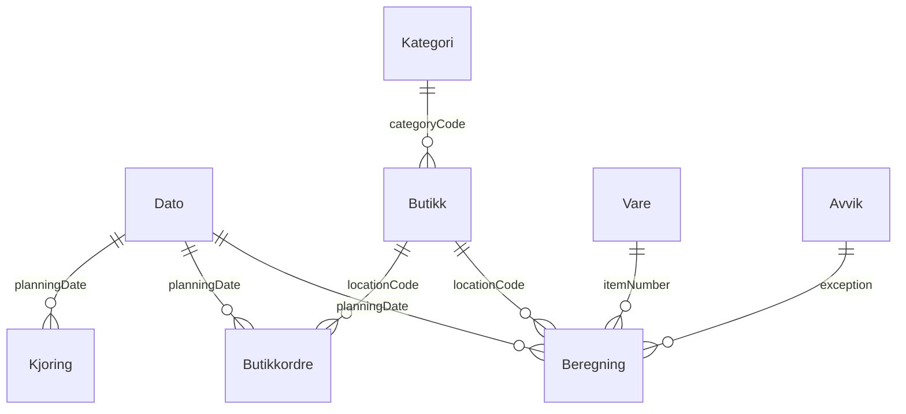

# DeliveryPlanner – Power BI-rapport

> Rapporten er laget som Power BI-prosjekt i `PowerBI/DeliveryPlanner.pbip`. Modellen der bruker norske kolonnenavn, for eksempel `Beregning[Beholdning]` i stedet for `inventory`. DAX-målene under viser logikken med API-navnene. Prosjektet er fasit.

Spesifikasjon for én rapport med tre faner: **Ledelse**, **Innkjøp** og **Lager og logistikk**. Dataene hentes fra DeliveryPlanner sine API-sider og standard-API-et til Business Central.

## 1. Målgrupper og spørsmål

| Fane | Målgruppe | Spørsmål |
|---|---|---|
| Ledelse | Ledelse, kategoriansvarlige | Blir tilgjengeligheten bedre? Hvor taper vi salg? Hvor mye kapital ligger i overlager? |
| Innkjøp | Innkjøpere | Hvilke varer mangler på hovedlageret? Hvilke varer er ofte tomme i butikk? Hvor er makslager satt feil? |
| Lager og logistikk | Lagerleder, logistikk | Hva skal ut til hvilke butikker? Hvilke ordrer venter på godkjenning? Gikk nattjobben bra? |

## 2. Datakilder

### 2.1 DeliveryPlanner-API (publisher `knowit`, gruppe `deliveryPlanner`, versjon `v1.0`)

| Entitetssett | Tabell | Innhold | Volum |
|---|---|---|---|
| `deliveryRuns` | DP Run KBS | Én rad per kjøring: status, tidsbruk, ordretall, salgskontroll | Lite |
| `deliveryRunLines` | DP Run Line KBS | Én rad per vare/variant/butikk per kjøring: salg, beholdning, behov, tildeling, avvik | **Stort** |
| `deliveryStoreOrders` | DP Store Order KBS | Én rad per opprettet overføringsordre: antall, snitt, godkjenning | Middels |
| `deliveryStores` | Location (ikke transitt) | Butikker: kategori, aktivering, leveringsdager | Lite |
| `deliveryStoreCategories` | DP Store Category KBS | Kategorier: dekningsdager, vekt | Lite |

URL-mønster:

```text
https://api.businesscentral.dynamics.com/v2.0/<tenant>/<miljø>/api/knowit/deliveryPlanner/v1.0/companies(<firma-id>)/deliveryRunLines
```

### 2.2 Standard-API (`v2.0`)

| Entitetssett | Felt som brukes |
|---|---|
| `items` | `number`, `displayName`, `itemCategoryCode`, `unitCost`, `baseUnitOfMeasureCode` |
| `itemCategories` | `code`, `displayName` |

### 2.3 Tilgang

- Bruker eller tjenestekonto for Power BI trenger rettighetssettet **DP API KBS** («DeliveryPlanner - Rapportering»), og i tillegg lesetilgang til varer og varekategorier, for eksempel **D365 READ**.
- Anbefalt oppdatering: daglig, etter at nattjobben er ferdig, for eksempel kl. 06:00.

## 3. Datamodell



| Tabell | Type | Kilde | Merknad |
|---|---|---|---|
| **Beregning** | Fakta | `deliveryRunLines` | Bare nattens gyldige kjøring per dato, se 4.2 |
| **Butikkordre** | Fakta | `deliveryStoreOrders` | |
| **Kjøring** | Fakta | `deliveryRuns` | Alle kjøringer, til fanen for drift |
| **Dato** | Dimensjon | Genereres i Power Query | Marker som datotabell. Ukenummer ISO, ukedag på norsk |
| **Butikk** | Dimensjon | `deliveryStores` | Leveringsdager som tekst, for eksempel «Man, Tor» |
| **Kategori** | Dimensjon | `deliveryStoreCategories` | Relasjon fra Butikk |
| **Vare** | Dimensjon | `items` + `itemCategories` | |
| **Avvik** | Dimensjon | Fast tabell, se 4.3 | Norsk navn og sortering |

Alle relasjoner er én-til-mange med enkel filterretning fra dimensjon til fakta.

**Beregningen er et øyeblikksbilde per natt.** Mål for beholdning, tomme varer og overlager må derfor aldri summeres over flere datoer. Bruk siste dato i utvalget, eller snitt per dag (se 5).

## 4. Power Query

### 4.1 Parametre

| Parameter | Eksempel | Bruk |
|---|---|---|
| `Miljo` | `Production` | Business Central-miljø |
| `Firma` | `[AVKLARES: firmanavn]` | Firma i miljøet |
| `RangeStart` / `RangeEnd` | Dato/tid | Kreves for inkrementell oppdatering |

### 4.2 Gyldige kjøringer og beregning

Det kan finnes flere kjøringer per dato, for eksempel en manuell «Beregn» i tillegg til nattjobben. Rapporten bruker bare den siste **fullførte** kjøringen med ordreopprettelse per planleggingsdato.

```powerquery
// Kilde_DP: felles navigasjon til DeliveryPlanner-API-et
let
    Kilde = Dynamics365BusinessCentral.ApiContentsWithOptions(null, null, null, null),
    Miljø = Kilde{[Name = Miljo]}[Data],
    Api = Miljø{[Name = "knowit/deliveryPlanner/v1.0"]}[Data],
    Selskap = Api{[Name = Firma]}[Data]
in
    Selskap
```

```powerquery
// GyldigeKjøringer
let
    Kjøringer = Kilde_DP{[Name = "deliveryRuns"]}[Data],
    Fullført = Table.SelectRows(Kjøringer, each [status] = "Completed" and [createOrders] = true),
    SistePerDato = Table.Group(Fullført, {"planningDate"},
        {{"Siste", each Table.Max(_, "startedAt"), type record}}),
    Utvidet = Table.ExpandRecordColumn(SistePerDato, "Siste", {"runId", "salesHistoryDays"})
in
    Utvidet
```

```powerquery
// Beregning
let
    Linjer = Kilde_DP{[Name = "deliveryRunLines"]}[Data],
    // Inkrementell oppdatering: filtrer på planleggingsdato tidlig, slik at filteret kan sendes til API-et.
    Periode = Table.SelectRows(Linjer, each
        [planningDate] >= Date.From(RangeStart) and [planningDate] < Date.From(RangeEnd)),
    Gyldige = Table.NestedJoin(Periode, {"runId"}, GyldigeKjøringer, {"runId"}, "Kjøring", JoinKind.Inner),
    MedPeriode = Table.ExpandTableColumn(Gyldige, "Kjøring", {"salesHistoryDays"}),
    UtenKobling = Table.RemoveColumns(MedPeriode, {"id", "reason"}),
    Typer = Table.TransformColumnTypes(UtenKobling, {
        {"planningDate", type date}, {"inventory", type number}, {"incomingQuantity", type number},
        {"maximumInventory", type number}, {"unmetQuantity", type number}, {"allocatedQuantity", type number},
        {"dailySales", type number}, {"daysOfCover", type number}, {"daysInStock", Int64.Type},
        {"salesHistoryDays", Int64.Type}})
in
    Typer
```

`reason` er fjernet for å holde modellen liten. Ta den med igjen hvis innkjøp vil se begrunnelsen per linje.

### 4.3 Avvik

Enum-verdier kommer fra API-et med kodede mellomrom (`_x0020_`). Bruk en fast tabell for norske navn og sortering:

```powerquery
// Avvik
#table(type table [exception = text, Avvik = text, Sortering = Int64.Type], {
    {"None", "Ingen", 0},
    {"Missing_x0020_Setup", "Mangler oppsett", 1},
    {"Out_x0020_of_x0020_Stock_x0020_Unmet_x0020_Need", "Tom – udekket behov", 2},
    {"Unmet_x0020_Need", "Udekket behov", 3},
    {"Out_x0020_of_x0020_Stock", "Tom i butikk", 4},
    {"Over_x0020_Maximum", "Over makslager", 5},
    {"Awaiting_x0020_Approval", "Venter på godkjenning", 6}
})
```

API-et returnerer enum-navnet, ikke bildeteksten. «Ingen» kommer derfor som `None`. Kontroller verdiene første gang.

### 4.4 Inkrementell oppdatering

| Tabell | Lagre | Oppdater |
|---|---|---|
| Beregning | 2 år | Siste 7 dager |
| Butikkordre | 2 år | Siste 30 dager. Godkjenningsstatus kan endres i ettertid |
| Kjøring | Full oppdatering | – |

- **Historikk:** DeliveryPlanner sletter kjøringer eldre enn «Behold kjøringslogg (dager)», standard 90. Med inkrementell oppdatering beholder Power BI historikken selv om den slettes i BC. Den første fulle oppdateringen kan bare hente det som fortsatt finnes i BC.
- **Volum:** Én rad per aktiv vare og butikk per natt. 50 butikker × 2 000 varer gir 100 000 rader per natt, eller om lag 36 millioner i året. Ved større volum bør Beregning aggregeres til uke × vare × butikk for data eldre enn 90 dager. [AVKLARES: antall aktive kombinasjoner av vare og butikk]
- **Filteroverføring:** Kontroller at filteret på `planningDate` faktisk sendes til API-et. Gjør det ikke det, bruk `OData.Feed` med `$filter=planningDate ge … and planningDate lt …` i stedet for BC-koblingen.

## 5. DAX-mål

Målene ligger i en egen målingstabell, `_Mål`, med visningsmapper.

### 5.1 Grunnmål

```dax
Beregnede linjer =
CALCULATE ( COUNTROWS ( Beregning ), Beregning[exception] <> "Missing_x0020_Setup" )

Siste dato =
CALCULATE ( MAX ( Beregning[planningDate] ) )

Netter =
DISTINCTCOUNT ( Beregning[planningDate] )
```

### 5.2 Tilgjengelighet og servicegrad

```dax
Tilgjengelighet % =
DIVIDE (
    CALCULATE ( [Beregnede linjer], Beregning[inventory] > 0 ),
    [Beregnede linjer]
)
// Andel vare-butikk-kombinasjoner med beholdning ved nattens kjøring.
// Snitt over alle netter i utvalget, brukes i trender.

Tilgjengelighet forrige periode % =
CALCULATE ( [Tilgjengelighet %], DATEADD ( Dato[Dato], -28, DAY ) )
// Sammenligner med samme utvalg flyttet 28 dager tilbake. Passer standardperioden på 28 dager.

Tilgjengelighet endring pp =
( [Tilgjengelighet %] - [Tilgjengelighet forrige periode %] ) * 100

Servicegrad 56 dager % =
VAR d = [Siste dato]
RETURN
    CALCULATE (
        DIVIDE (
            SUMX (
                FILTER ( Beregning, Beregning[exception] <> "Missing_x0020_Setup" ),
                Beregning[daysInStock]
            ),
            SUMX (
                FILTER ( Beregning, Beregning[exception] <> "Missing_x0020_Setup" ),
                Beregning[salesHistoryDays]
            )
        ),
        Beregning[planningDate] = d
    )
// Samme tall som i appen og i kø-delen: dager på lager / analysedager, siste natt.
```

### 5.3 Tomme varer og udekket behov

```dax
Tomme varer (siste natt) =
VAR d = [Siste dato]
RETURN CALCULATE ( [Beregnede linjer], Beregning[inventory] <= 0, Beregning[planningDate] = d )

Tomme butikkdager =
CALCULATE ( [Beregnede linjer], Beregning[inventory] <= 0 )
// Antall netter × kombinasjoner som var tomme. Kan summeres over perioden.

Udekket behov (enheter) =
SUM ( Beregning[unmetQuantity] )

Udekket behov (kr) =
SUMX ( Beregning, Beregning[unmetQuantity] * RELATED ( Vare[unitCost] ) )

Tapte salgsdager (estimat, kr) =
SUMX (
    FILTER ( Beregning, Beregning[inventory] <= 0 ),
    Beregning[dailySales] * RELATED ( Vare[unitCost] )
)
// Grovt estimat i innkjøpsverdi: salg per dag × dager tom. Ikke salgsverdi.
```

### 5.4 Lager og overlager

```dax
Overlager (enheter, siste natt) =
VAR d = [Siste dato]
RETURN
    SUMX (
        FILTER ( Beregning, Beregning[planningDate] = d && Beregning[maximumInventory] > 0 ),
        MAX ( 0, Beregning[inventory] + Beregning[incomingQuantity] - Beregning[maximumInventory] )
    )

Overlager (kr, siste natt) =
VAR d = [Siste dato]
RETURN
    SUMX (
        FILTER ( Beregning, Beregning[planningDate] = d && Beregning[maximumInventory] > 0 ),
        MAX ( 0, Beregning[inventory] + Beregning[incomingQuantity] - Beregning[maximumInventory] )
            * RELATED ( Vare[unitCost] )
    )

Lagerverdi butikk (kr, siste natt) =
VAR d = [Siste dato]
RETURN
    SUMX (
        FILTER ( Beregning, Beregning[planningDate] = d ),
        MAX ( 0, Beregning[inventory] ) * RELATED ( Vare[unitCost] )
    )

Snitt dager med dekning =
AVERAGEX ( FILTER ( Beregning, Beregning[dailySales] > 0 ), Beregning[daysOfCover] )

Makslager-treff =
CALCULATE ( [Beregnede linjer], Beregning[capacityQuantity] = 0, Beregning[dailySales] > 0 )
// Netter der makslageret stoppet påfyllingen for en vare som selger.
```

### 5.5 Ordrer

```dax
Ordrer = COUNTROWS ( Butikkordre )

Enheter sendt = SUM ( Butikkordre[quantity] )

Tildelt (enheter) = SUM ( Beregning[allocatedQuantity] )

Ordrer til godkjenning =
CALCULATE ( [Ordrer], Butikkordre[approvalStatus] = "Awaiting_x0020_Approval" )

Ordrestørrelse mot snitt =
DIVIDE (
    CALCULATE ( SUM ( Butikkordre[quantity] ), Butikkordre[averageQuantity] > 0 ),
    CALCULATE ( SUM ( Butikkordre[averageQuantity] ), Butikkordre[averageQuantity] > 0 )
)
```

### 5.6 Drift

```dax
Nattkjøringer = CALCULATE ( COUNTROWS ( Kjøring ), Kjøring[createOrders] = TRUE () )

Nattjobb OK % =
DIVIDE ( CALCULATE ( [Nattkjøringer], Kjøring[status] = "Completed" ), [Nattkjøringer] )

Snitt kjøretid (min) =
AVERAGEX (
    FILTER ( Kjøring, Kjøring[status] = "Completed" ),
    ( Kjøring[finishedAt] - Kjøring[startedAt] ) * 24 * 60
)

Salgsvarsler = CALCULATE ( COUNTROWS ( Kjøring ), Kjøring[salesWarning] = TRUE () )
```

## 6. Fanene

Alle fanene har de samme slicerne øverst: **periode** (standard siste 28 dager), **butikkategori**, **butikk** og **varekategori**. Slicerne er synkronisert mellom fanene.

### 6.1 Ledelse

| Visual | Innhold |
|---|---|
| 4 kort | Tilgjengelighet % med endring mot forrige periode. Tomme varer (siste natt). Overlager (kr). Udekket behov (kr) i perioden |
| Linjediagram | Tilgjengelighet % per uke, én linje per butikkategori, med mål 95 % som konstant linje |
| Matrise (heatmap) | Butikk × uke, Tilgjengelighet % med betinget farge (rød < 90, gul < 95, grønn ≥ 95) |
| Stolpediagram | Topp 10 butikker med lavest tilgjengelighet |
| Stolpediagram | Tapte salgsdager (kr) per varekategori |
| Kort | Lagerverdi i butikk (kr) og Overlager i andel av lagerverdi |

### 6.2 Innkjøp

| Visual | Innhold |
|---|---|
| 3 kort | Udekket behov (enheter og kr) i perioden. Antall varer med udekket behov. Antall «Mangler oppsett» |
| Tabell | **Mangel på hovedlageret:** vare, beskrivelse, varekategori, udekket enheter, udekket kr, antall butikker berørt og antall netter. Sortert på kr |
| Tabell | **Ofte tomme i butikk:** vare, tomme butikkdager, snitt dager med dekning, daglig salg. Drill til butikk |
| Tabell | **Overlager:** vare × butikk, overlager enheter og kr, makslager og daglig salg. Kandidater for lavere makslager |
| Tabell | **Makslager for lavt:** varer med flest makslager-treff og samtidig tomme butikkdager. Kandidater for høyere makslager |
| Tabell | **Mangler oppsett:** vare, butikk, begrunnelse (krever `reason`), siste natt |

### 6.3 Lager og logistikk

| Visual | Innhold |
|---|---|
| 4 kort | Ordrer og enheter sendt i perioden. Ordrer til godkjenning (nå). Nattjobb OK %. Snitt kjøretid |
| Stablet stolpediagram | Enheter sendt per butikk per ukedag. Viser belastningen per leveringsdag |
| Tabell | **Siste natt:** butikk, mottaksdato, antall linjer og enheter tildelt. Pakkeliste-oversikt |
| Tabell | **Til godkjenning:** butikk, overføringsordre, antall, snitt og faktor |
| Linjediagram | Ordrestørrelse mot snitt per uke |
| Tabell | **Nattjobb:** dato, status, kjøretid per steg, ordrer, salgsvarsel, butikker uten salg og feilmelding |
| Kort | Salgsvarsler i perioden |

## 7. Leveranse

| Steg | Ansvar |
|---|---|
| Installer DeliveryPlanner med API-sidene, og gi Power BI-kontoen DP API KBS og D365 READ | Knowit |
| Bygg modellen og fanene i Power BI Desktop etter denne spesifikasjonen | [AVKLARES: hvem] |
| Publiser til arbeidsområdet, sett opp inkrementell oppdatering og daglig oppdatering | [AVKLARES: arbeidsområde] |
| Del rapporten med de tre målgruppene, eventuelt med én app-fane per målgruppe | Kunde |
