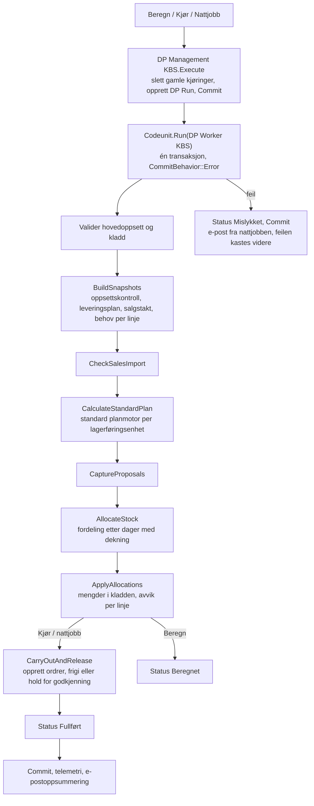

# Arkitektur

## Kjøringsflyt

- **Én transaksjon:** `DP Worker KBS` har `[CommitBehavior(CommitBehavior::Error)]`. Feiler noe, rulles alle nye ordrer og kladdlinjer tilbake, mens kjøringen beholdes med status Mislykket og feilmelding.
- **Ingen samtidige kjøringer:** `Setup.LockTable()` sørger for at bare én kjøring går om gangen.
- **Alle butikker samtidig:** Kjøringen er bevisst ikke delt opp, fordi fordelingen må se alle butikker for en vare på én gang.

## Bruk av standard planmotor

Utvidelsen lar BC sin egen planlegging (`Inventory Profile Offsetting`) lage forslagene. Planparametrene overstyres bare i minnet, gjennom manuelt bundne event subscribers i `DP Planning Adapter KBS`:

| Event | Hensikt |
|---|---|
| `Planning-Get Parameters.OnAfterAdjustInvalidSettings` | Maximum Qty. med lagermålet som makslager. Lagerføringsenheten endres ikke |
| `Inventory Profile Offsetting.OnFindCombinationOnBeforeSKUFindSet` / `OnPlanItemOnBeforeTempSKUFind` | Planlegger bare én lagerføringsenhet om gangen |
| `Inventory Profile Offsetting.OnCalculatePlanFromWorksheetOnBeforeUnfoldItemTracking` | Eksisterende forsyning endres ikke |
| `Carry Out Action.OnInsertTransHeaderOnBeforeTransHeaderInsert` / `OnAfterInsertTransLine` | Kjørings-ID på ordren og kobling til forslagsloggen |
| `DP Worksheet Guard KBS.OnCheckAccess` | Skrivetilgang til den låste kladden mens kjøringen pågår |

`DP Worksheet Guard KBS` stopper alle endringer i den dedikerte kladden utenfor kjøringen: innsetting, endring, sletting, omdøping og «Utfør handlingsmeldinger». `DP Approval KBS` abonnerer på `Release Transfer Document.OnAfterReleaseTransferDoc`, slik at standard Frigi godkjenner en ventende ordre.

## Kodeenheter

| ID | Navn | Ansvar |
|---|---|---|
| 78900 | DP Management KBS | Inngangspunkt: oppsett, Beregn, Kjør, nattjobb, opprydding, telemetri, makslager fra varekortet, masseoppdatering |
| 78901 | DP Worker KBS | Hele kjøringen i én transaksjon |
| 78902 | DP Job Queue KBS | Jobbkø-inngang |
| 78903 | DP Planning Adapter KBS | Subscribers mot planmotoren, ordreopprettelse og godkjenning |
| 78904 | DP Worksheet Guard KBS | Sperre mot manuelle endringer i kladden |
| 78905 | DP Inventory KBS | Salgstakt, beholdning, inngående, utgående og behov |
| 78906 | DP Allocation KBS | Fordeling etter dager med dekning og avrunding |
| 78907 | DP Upgrade KBS | Upgrade codeunit med upgrade tag |
| 78908 | DP Delivery Schedule KBS | Mottaksdato, leveringsdag og dekningsperiode |
| 78909 | DP Setup Check KBS | Kontroll av butikk- og SKU-oppsett per linje |
| 78910 | DP KPI Mgt KBS | Siste kjøring og nøkkeltall |
| 78911 | DP Notification KBS | Innhold i e-postvarsler |
| 78912 | DP Send Email KBS | Sender e-post via `Codeunit.Run`, slik at feil fanges |
| 78913 | DP Approval KBS | Ordresnitt, grense og godkjenning ved frigivelse |

## Data

| ID | Tabell | Innhold |
|---|---|---|
| 78900 | DP Setup KBS | Oppsett (én post) |
| 78901 | DP Store Category KBS | Kategorier: dekningsdager og vekt |
| 78902 | DP Run KBS | Én post per kjøring: status, tidsbruk, ordretall, salgskontroll |
| 78903 | DP Run Line KBS | Beregningsgrunnlag og avvik per vare/variant/butikk |
| 78904 | DP Proposal Log KBS | Kladdforslag og kobling til overføringslinjer |
| 78905 | DP Allocation Buffer KBS | Midlertidig, brukes av fordelingen |
| 78906 | DP KPI Buffer KBS | Midlertidig, brukes av nøkkeltallene |
| 78907 | DP Store Order KBS | Ordrehistorikk per butikk, grunnlag for godkjenning |

Tabellutvidelser:

| Tabell | Felt |
|---|---|
| Location | Aktivering, kategori og sju leveringsdager |
| Stockkeeping Unit | Aktivering |
| Item | Makslager for liten, mellomstor og stor butikk |
| Requisition Line | Kjørings-ID, mål, vekt, forslag og begrunnelse |
| Transfer Header | Kjørings-ID og godkjenningsstatus |

Den fullstendige objektoversikten, med sider, sideutvidelser, enumer, query og rettighetssett, står i `Docs/DeliveryPlanner - Teknisk spesifikasjon.md`.

## Ytelse

- Salgstakten leser én rad per dag og posttype per lagerføringsenhet, gjennom query `DP Daily Item Movement KBS`. Den leser ikke hver enkelt transaksjon.
- Salgskontrollen bruker de samme tallene og gjør ingen ekstra spørring mot alle vareposter.
- Leveringsplanen og oppsettskontrollen av butikken regnes én gang per butikk.
- Tid per steg lagres på `DP Run KBS` og sendes som telemetri:

| Telemetri | Når |
|---|---|
| `DP0001` | Kjøringen er fullført |
| `DP0002` | Kjøringen feilet |
| `DP0003` | E-post kunne ikke sendes |
